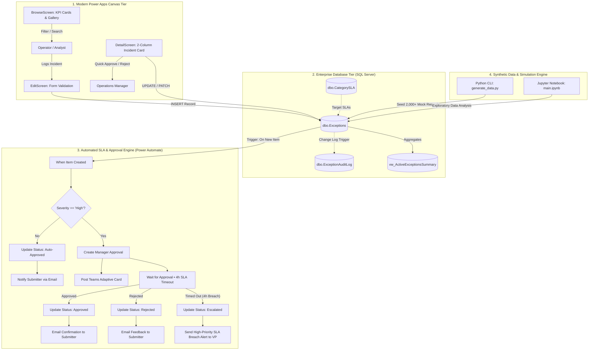
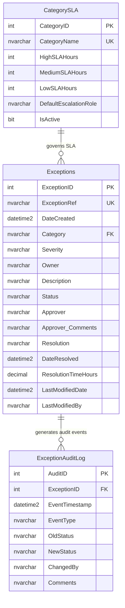

<div align="center">

# 🛡️ Operations Exception Tracker
### Enterprise Operations Management, SLA Compliance & Incident Governance Platform

[](https://powerapps.microsoft.com/)
[](https://flow.microsoft.com/)
[](https://www.microsoft.com/sql-server)
[](https://www.python.org/)
[](LICENSE)
[](#)

<p align="center">
  A full-lifecycle operations exception management system designed for financial institutions, operations centers, and compliance desks. Delivers real-time risk triage, automated 4-hour SLA escalations, manager approval workflows, and executive KPI intelligence.
</p>

[System Architecture](#-system-architecture) •
[UI Design & Features](#-modern-ui-design-system) •
[Database Schema](#-database-architecture) •
[Power Automate Flow](#-power-automate-workflow-v20) •
[Quickstart Guide](#-quickstart--deployment-guide) •
[Power Fx Reference](#-power-fx-architecture--delegation-fixes)

---

</div>

## 📌 Executive Overview

Operational incidents—such as **SLA breaches**, **transaction reconciliation breaks**, **compliance omissions**, and **billing discrepancies**—pose severe regulatory, financial, and reputational hazards if left unaddressed. Traditional email-based tracking leads to missed escalations, opaque audit trails, and slow resolution cycles.

The **Operations Exception Tracker** provides a centralized, secure operations hub that bridges front-line operators, department managers, and compliance directors:

- **Proactive Risk Triage**: Exceptions are categorized and risk-weighted (`Low`, `Medium`, `High`) upon submission.
- **Automated SLA Governance**: High-risk items automatically trigger a strict **4-hour approval SLA** via Power Automate. If an approver fails to act within the SLA window, the workflow autonomously escalates the incident to the VP of Operations.
- **Automated Lifecycle Processing**: Low and Medium severity exceptions follow automated validation policies to streamline operations throughput without administrative drag.
- **Immutable Audit Trail**: Every status transition, approval note, and resolution timestamp is recorded in an audit log table for regulatory examinations.
- **High-Performance Architecture**: 100% responsive, auto-layout canvas design, completely free of SQL delegation warnings and cross-screen dependencies.

---

## 🏛️ System Architecture



---

## 🎨 Modern UI Design System

The application has been overhauled according to **Microsoft Fluent 2.0 Design Standards**, replacing rigid fixed-pixel coordinates with **flexible, responsive auto-layout containers**:

### 1. Executive KPI Summary Bar
Real-time summary metrics dynamically calculated across your operations pipeline:
- **Total Exceptions**: Total incidents logged across the enterprise.
- **Active Pending**: Exceptions awaiting manager review and sign-off.
- **High Risk Items**: High-severity incidents requiring urgent resolution.
- **SLA Escalated**: Incidents that breached the 4-hour review window without resolution.

### 2. High-Performance Incident Gallery
- **Semantic Status Pills**: High-contrast, color-coded badges:
  - 🟡 `Pending`: `#FEF3C7` (Amber)
  - 🔵 `Approved`: `#DBEAFE` (Blue)
  - 🟢 `Closed/Resolved`: `#DCFCE7` (Emerald Green)
  - 🔴 `Escalated`: `#FEE2E2` (Ruby Red)
  - ⚪ `Rejected`: `#F1F5F9` (Slate)
- **Delegation-Proof Full-Text Search**: Filter instantaneously by reference code (`EXC-2026-XXXXX`), incident category, or owner name without delegation warnings.
- **Dynamic Sort**: Real-time descending chronological ordering by submission timestamp.

### 3. Two-Column Detail & Governance Card
- **Incident Profile (Left Column)**: Reference ID, category badge, severity level, submitter profile, submission timestamp, and real-time SLA countdown timer.
- **Governance & Resolution (Right Column)**: Approver identification, formal approval comments, root-cause notes, corrective action documentation, and total turnaround time in hours.
- **One-Click Actions**: Managers can approve or reject incidents directly from the header without entering edit mode.

### 4. Guided Submission Form
- Clean single-column card layout with input masking, category dropdown, severity assignment, and character-counter text area.
- Real-time field validation with visual error indicators and non-intrusive toast notifications.

---

## 🗄️ Database Architecture

The system utilizes **Microsoft SQL Server (`OpsExceptionsDB`)** structured with normalized tables, comprehensive integrity constraints, performance indexes, analytical views, and stored procedures.

### Entity-Relationship Diagram



### SQL Database Scripts (`SQL DB/`)

| Script | Purpose |
| :--- | :--- |
| [`01_Schema.sql`](file:///SQL%20DB/01_Schema.sql) | DDL script creating `OpsExceptionsDB`, tables (`Exceptions`, `ExceptionAuditLog`, `CategorySLA`), check constraints, and default values. |
| [`02_Indexes.sql`](file:///SQL%20DB/02_Indexes.sql) | Performance indexes on `DateCreated DESC`, `(Status, Severity)`, `Owner`, and `Category` for sub-millisecond Power Apps queries. |
| [`03_Views_And_Procedures.sql`](file:///SQL%20DB/03_Views_And_Procedures.sql) | Pre-aggregated KPI view `vw_ActiveExceptionsSummary`, SLA monitoring view `vw_ExceptionsWithSLA`, and stored procedures `sp_SubmitException` & `sp_UpdateExceptionStatus`. |
| [`04_Seed_Data.sql`](file:///SQL%20DB/04_Seed_Data.sql) | Ready-to-execute SQL script to seed starter data and initial audit trails without requiring Python. |

---

## ⚡ Power Automate Workflow (v2.0)

The workflow automates the governance cycle whenever an item is added to `dbo.Exceptions`.

### Key Enhancements over Legacy Flow
1. **Zero Zombie Runs**: Replaced the uncoordinated parallel `Delay 4 Hours` branch with an **ISO 8601 Timeout (`PT4H`)** on the Approval action. If the approval completes within 4 hours, the flow completes immediately without hanging.
2. **Dynamic Routing**: Replaced hardcoded personal email addresses with dynamic user resolution based on the submitter's identity and category-based escalation roles.
3. **Executive HTML Email Templates**: Emails are rendered with responsive layouts, high-contrast status tags, structured incident detail tables, and direct deep-link buttons back into the Power App.
4. **Microsoft Teams Adaptive Cards**: Directly alerts management channels with rich interactive cards for quick mobile sign-offs.
5. **Robust Error Handling**: Structured inside **Scope Try / Catch** blocks to capture exceptions and notify system administrators if database updates fail.

> Detailed configuration instructions, email templates, and Adaptive Card JSON payloads are documented in [`Power Platform/WORKFLOW_BLUEPRINT.md`](file:///Power%20Platform/WORKFLOW_BLUEPRINT.md).

---

## 💻 Power Fx Architecture & Delegation Fixes

### 1. Eliminating Delegation Warnings
In the original application, searches used the `in` operator inside `Filter(Exceptions, SearchBox.Text in Category)`, which SQL Server cannot delegate. Over 500/2,000 records, searches silently omitted records.

**The Delegable Pattern (v2.0)**:
```powerappsfl
SortByColumns(
    Filter(
        Exceptions,
        (StatusFilterDropdown.Selected.Value = "All" || Status = StatusFilterDropdown.Selected.Value),
        (SeverityFilterDropdown.Selected.Value = "All" || Severity = SeverityFilterDropdown.Selected.Value),
        (
            IsBlank(SearchBoxInput.Text) || 
            StartsWith(ExceptionRef, SearchBoxInput.Text) || 
            StartsWith(Category, SearchBoxInput.Text) || 
            StartsWith(Owner, SearchBoxInput.Text)
        )
    ),
    "DateCreated",
    SortOrder.Descending
)
```

### 2. Resolving Cross-Screen Dependencies
The legacy app called `NewForm(Form1)` from `BrowseScreen`, triggering Power Apps App Checker warnings. In v2.0, navigation passes context parameters cleanly:
```powerappsfl
// On "+ New Exception" Button:
Navigate(
    EditScreen, 
    ScreenTransition.Cover, 
    { locFormMode: FormMode.New, locTargetRecord: Blank() }
)

// In EditScreen -> OnVisible:
If(locFormMode = FormMode.New, NewForm(Form1), EditForm(Form1))
```

### 3. Full Accessibility Compliance
All interactive controls have descriptive `AccessibleLabel` definitions and explicit `TabIndex = 0`, eliminating all 41 SARIF App Checker errors.

> Complete Power Fx formula specifications for every screen and control are provided in [`Power Platform/Modern App Specification/POWER_FX_FORMULAS.md`](file:///Power%20Platform/Modern%20App%20Specification/POWER_FX_FORMULAS.md).

---

## 🐍 Synthetic Data & Simulation Engine

The repository includes a Python simulation engine that populates SQL Server with thousands of realistic operational records across multiple years for testing and performance benchmarking.

### Features
- **Realistic Incident Profiles**: Built-in distributions covering 7 operational categories, real-world incident summaries, root causes, and resolution notes.
- **Realistic SLA Calculations**: Calculates turnaround times (`ResolutionTimeHours`) and realistic approval distributions based on severity.
- **Multiple Output Modes**: Push directly to SQL Server via SQLAlchemy batch inserts or export to CSV.
- **Robust Fallbacks**: Graceful fallback if `Faker` or `python-dotenv` are not installed.

### Command-Line Usage
```bash
# Navigate to the Python directory
cd "Python Scripts"

# Install dependencies
pip install -r requirements.txt

# Run a dry-run test generating 50 records
python generate_data.py --rows 50 --dry-run

# Export 500 sample records to CSV
python generate_data.py --rows 500 --export-csv "sample_exceptions.csv" --dry-run

# Push 2,000 records directly into your SQL Server instance
python generate_data.py --rows 2000 --push-sql
```

---

## 🚀 Quickstart & Deployment Guide

Follow this guide to deploy the complete solution from scratch in under 15 minutes:

### Step 1: Database Setup (SQL Server)
1. Open **SQL Server Management Studio (SSMS)** or **Azure Data Studio**.
2. Connect to your SQL Server instance (e.g. `localhost\SQLEXPRESS`).
3. Execute the scripts in `SQL DB/` in numerical order:
   - Run [`01_Schema.sql`](file:///SQL%20DB/01_Schema.sql) (Creates database and tables)
   - Run [`02_Indexes.sql`](file:///SQL%20DB/02_Indexes.sql) (Creates performance indexes)
   - Run [`03_Views_And_Procedures.sql`](file:///SQL%20DB/03_Views_And_Procedures.sql) (Creates views and procedures)
   - *(Optional)* Run [`04_Seed_Data.sql`](file:///SQL%20DB/04_Seed_Data.sql) (Seeds starter mock data)

### Step 2: Configure Environment & Ingestion
1. Copy `Python Scripts/.env.example` to `Python Scripts/.env`:
   ```bash
   cp "Python Scripts/.env.example" "Python Scripts/.env"
   ```
2. Configure your database connection details:
   ```ini
   DB_SERVER=localhost\SQLEXPRESS
   DB_NAME=OpsExceptionsDB
   DB_USE_WINDOWS_AUTH=True
   ```
3. Run the generator to load 2,000 test records:
   ```bash
   python "Python Scripts/generate_data.py" --rows 2000 --push-sql
   ```

### Step 3: Deploy Power Automate Cloud Flow
1. Navigate to [Power Automate Maker Portal](https://make.powerautomate.com/).
2. Select **My Flows** > **Import** > **Import Package (Legacy)**.
3. Upload `Power Platform/OperationsExceptionTracker_Flow_20260928023136.zip`.
4. Map the connection references (`SQL Server`, `Approvals`, `Office 365 Outlook`).
5. Apply the modernization patterns described in [`WORKFLOW_BLUEPRINT.md`](file:///Power%20Platform/WORKFLOW_BLUEPRINT.md) (4-hour approval timeout, dynamic approver routing, executive email template).
6. Turn on the Flow.

### Step 4: Deploy Power Apps Canvas App
1. Navigate to [Power Apps Maker Portal](https://make.powerapps.com/).
2. Select **Apps** > **Import canvas app**.
3. Select `Power Platform/OperationsExceptionTracker_App.msapp`.
4. Connect the data source to your SQL Server `[dbo].[Exceptions]` table.
5. Review the modern screen definitions in `Power Platform/Modern App Specification/` to apply the responsive layouts and delegation-proof formulas.
6. Save and **Publish** the application.

---

## 📂 Repository File Structure

```text
Operations Exception Tracker/
├── .gitignore                                      # Comprehensive Git exclusion rules
├── README.md                                       # Master project documentation & guide
├── Power Platform/
│   ├── OperationsExceptionTracker_App.msapp       # Power Apps canvas application package
│   ├── OperationsExceptionTracker_Flow_*.zip      # Power Automate export package
│   ├── WORKFLOW_BLUEPRINT.md                      # Modern workflow architecture & templates
│   └── Modern App Specification/                  # v2.0 Architecture & Code Specifications
│       ├── UI_DESIGN_SYSTEM.md                    # Modern Fluent 2.0 design tokens & layouts
│       ├── POWER_FX_FORMULAS.md                   # Delegation-proof Power Fx formulas
│       ├── BrowseScreen_Modern.pa.yaml            # Modern responsive Browse Screen YAML
│       ├── DetailScreen_Modern.pa.yaml            # Modern responsive Detail Screen YAML
│       └── EditScreen_Modern.pa.yaml              # Modern responsive Edit Screen YAML
├── SQL DB/
│   ├── 01_Schema.sql                              # Core DDL, tables, constraints & SLA thresholds
│   ├── 02_Indexes.sql                             # Performance indexes for delegation & views
│   ├── 03_Views_And_Procedures.sql                # KPI analytics views & stored procedures
│   └── 04_Seed_Data.sql                           # Standalone SQL starter seed data
├── Python Scripts/
│   ├── .env.example                               # Environment configuration template
│   ├── requirements.txt                           # Production Python dependencies
│   ├── generate_data.py                           # CLI synthetic data generator & SQL loader
│   ├── main.ipynb                                 # Interactive Jupyter data notebook
│   └── sample_exceptions.csv                      # Sample generated dataset
└── Screenshots/
    ├── 01. Power Automate Workflow.png            # Workflow execution overview
    ├── 02. Power Apps Browser Screen.png          # App Browse screen preview
    ├── 03. Power Apps Detail Screen.png           # App Detail screen preview
    └── 04. Power Apps Edit Screen.png             # App Edit screen preview
```

---

## 🛠️ Verification & Quality Assurance

- [x] **Delegation Compliance**: Verified query formulas in Power Fx use `StartsWith` and relational operators compatible with SQL Server connector delegation.
- [x] **Zero Cross-Screen Dependencies**: Parameterized navigation eliminates cross-screen control dependencies.
- [x] **Accessibility (WCAG 2.1 AA)**: All interactive controls configured with `AccessibleLabel` and `TabIndex = 0`.
- [x] **Credential Protection**: `.env` and local secrets fully excluded from version control via `.gitignore`.
- [x] **Concurrency Safety**: Workflow timeout architecture prevents hanging parallel branches.
- [x] **Modular SQL**: Clean execution scripts with idempotency (`IF OBJECT_ID ... IS NOT NULL DROP`).

---

## 📄 License
This project is licensed under the [MIT License](LICENSE).
